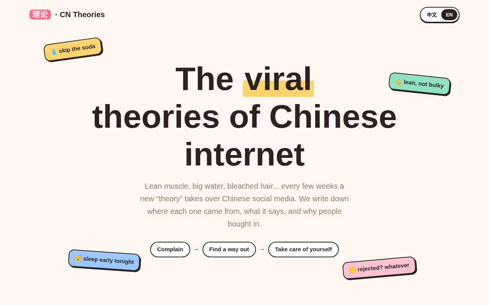

<a href="README.md">中文</a> | English

<b>From the Repression Theory to the Big Water Theory: the viral "theories" of the Chinese internet, all in one place.</b> 
<a href="https://grokkkkkk.github.io/cn-theories/?lang=en">Browse online</a> · <a href="PENDING.md">Still being verified (zh)</a>

If you find it interesting, a ⭐ helps. Spotted a new theory? PRs welcome.

# CN Theories: How Chinese Internet "Theories" Evolve

Every few weeks, Chinese social media latches onto a new "XX theory" (XX理论) or "XX mindset" (XX思维): drink big water, build lean muscle, think like a bleached-hair guy. This repo writes each one down: where it came from, when it blew up, what it actually says, what critics say, and what the facts are.

Put side by side, they tell a story. The 2025 wave was mostly dark jokes about dating and class. The 2026 wave stopped complaining and started doing small, concrete things: drink water, sleep, train, look after yourself.

> This is a record of a social phenomenon, not an endorsement of any theory. Health-related entries are not medical advice.

## Timeline

| Wave | Theory | In one line | First seen / went viral | Origin / platform | Entry |
|---|---|---|---|---|---|
| 2025 · The Big Three | The Repression Theory (性压抑论) | Every guy's problem, traced back to one root: repression. | 2025 (reported 2025-09-24) | 峰哥亡命天涯 / Livestream | [Entry (zh)](theories/2025/xingyayi-lun.md) |
| 2025 · The Big Three | The Laborer Mindset (力工思维论) | Scrimp for years, then go all-in to 'buy' a marriage. | 2025 (reported 2025-09-24) | 好师兄戴梦 / Douyin | [Entry (zh)](theories/2025/ligong-siwei.md) |
| 2025 · The Big Three | iPhone vs Android Relativity (苹果安卓相对论) | Tell me your phone, and I'll tell you your class. | 2025 (reported 2025-09-24) | 户晨风 / Livestream | [Entry (zh)](theories/2025/pingguo-anzhuo.md) |
| 2026 · The New Wave | The Lean Muscle Theory (薄肌理论) | Not bulky, just lean and defined. The point is the muscle, not the thin. | 2026-08-17 | 邵艾伦 / X | [Entry (zh)](theories/2026/baoji-lilun.md) |
| 2026 · The New Wave | The Bleached-Hair Mindset (黄毛思维) | Not about dyeing your hair. It's about having a life of your own first. | 2026-09-15 | 邵艾伦 / Bilibili | [Entry (zh)](theories/2026/huangmao-siwei.md) |
| 2026 · The New Wave | The Big Sleep Theory (大睡理论) | No more late nights. Go to bed on time and get your eight hours. | 2026-10 | Douyin | [Entry (zh)](theories/2026/dashuijiao-lilun.md) |
| 2026 · The New Wave | The Small Water Theory (小水理论) | The counter-take on big water: small bottles are cleaner and easier to carry. Sip often. | 2026-10 | Douyin | [Entry (zh)](theories/2026/xiaoshui-lilun.md) |
| 2026 · The New Wave | The Big Cup Theory (大杯理论) | Get a cup as big as a 2L bottle and refill it for free at work or school. | 2026-10 | Douyin | [Entry (zh)](theories/2026/dabei-lilun.md) |
| 2026 · The New Wave | The Big Veggie Theory (大菜理论) | Big water isn't enough. Pair it with a big plate of greens. | 2026-10 | Douyin | [Entry (zh)](theories/2026/dacai-lilun.md) |
| 2026 · The New Wave | Quit the Student Mindset (拒绝学生思维) | Stop waiting for the right answer or for someone to tell you what to do. Decide, and own it. | 2026-10 | Short-video apps | [Entry (zh)](theories/2026/jujue-xuesheng-siwei.md) |
| 2026 · The New Wave | The Abstinence Theory (戒色理论) | Treats normal desire as something to quit, often with wildly overblown claims. | 2026-10 | Short-video apps | [Entry (zh)](theories/2026/jiese-lilun.md) |
| 2026 · The New Wave | The Big Water Theory (大水理论) | Ditch the bubble tea. Carry a 2-liter bottle of water instead. | 2026-10-05 | Douyin | [Entry (zh)](theories/2026/dashui-lilun.md) |
| 2026 · The New Wave | The Big Stand Theory (大站理论) | Don't sit all day. Get up and stand for five minutes every hour. | 2026-10-13 | 三个人一本书 / Xiaoyuzhou podcast | [Entry (zh)](theories/2026/dazhan-lilun.md) |
| 2026 · The New Wave | The Bell Pepper Theory (彩椒理论) | Make bell peppers your go-to vegetable. Easy, tasty, and colorful. | 2026-10-14 | Weibo | [Entry (zh)](theories/2026/caijiao-lilun.md) |

Full entries are in Chinese for now. English translations are welcome as PRs.

## Commentary
- [好师兄戴梦: from the Big Three to the new theories](commentary/daimeng-from-three-theories.md) (summary of the creator's view, zh)

## Layout
- `theories/<year>/`: one entry per theory
- `commentary/`: summaries of third-party takes, credited
- `templates/theory.md`: entry template
- `data/theories.json`: structured index (zh + en fields)

## License
Content CC BY-SA 4.0, code MIT. See [LICENSE](LICENSE).
