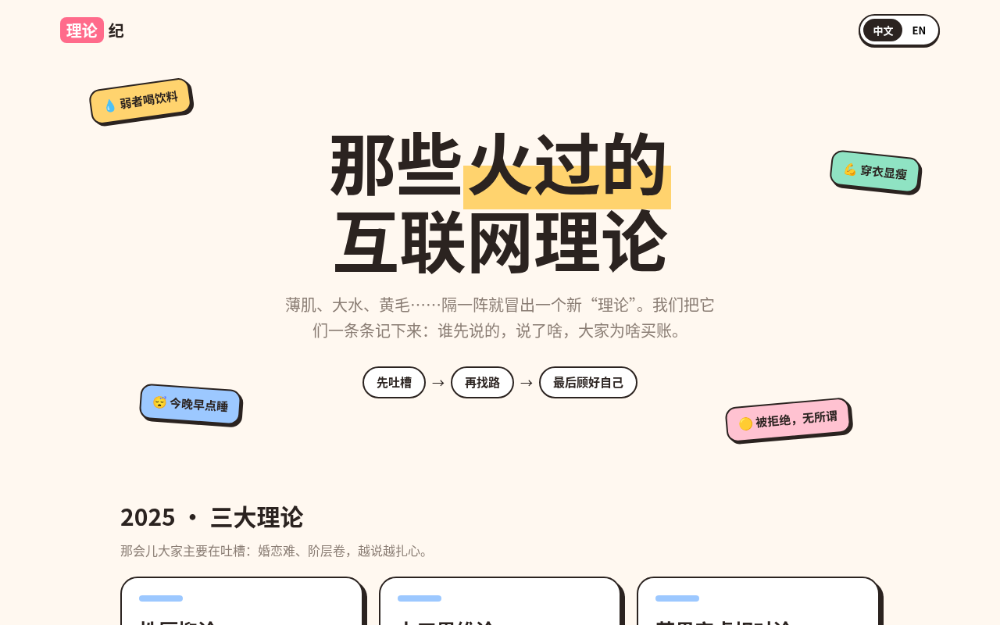

中文 | <a href="README.en.md">English</a>

<b>从性压抑论到大水理论，中文互联网的“XX理论”都在这儿了。</b> 
<a href="https://grokkkkkk.github.io/cn-theories/">在线浏览</a> · <a href="https://grokkkkkk.github.io/cn-theories/?lang=en">English</a> · <a href="PENDING.md">还在考证的</a>

觉得有意思的话，点个 ⭐ 吧。刷到新理论也欢迎提 PR。

# 中文互联网理论演变观察（xx-theories）

收录中文互联网上以“XX理论 / XX思维”命名的流行说法，记录它们的出处、时间线、核心观点、争议和事实核查，并观察不同代际理论之间的演变。

> 本仓库为社会现象记录，不代表认同任何理论观点；健康类内容不构成医疗建议。

## 时间线索引（按代际）

| 代际 | 理论 | 一句话 | 首次出现 / 走红 | 提出者 / 平台 | 条目 |
|---|---|---|---|---|---|
| 2025「三大理论」 | 性压抑论 | 男生的毛病，最后都能归到“憋的”。 | 2025 年（报道见 2025-09-24） | 峰哥亡命天涯 / 直播 | [链接](theories/2025/xingyayi-lun.md) |
| 2025「三大理论」 | 力工思维论 | 省吃俭用攒一辈子，一把梭哈换个婚姻。 | 2025 年（报道见 2025-09-24） | 好师兄戴梦 / 抖音 | [链接](theories/2025/ligong-siwei.md) |
| 2025「三大理论」 | 苹果安卓相对论 | 你用什么手机，你就是什么阶层。 | 2025 年（报道见 2025-09-24） | 户晨风 / 直播 | [链接](theories/2025/pingguo-anzhuo.md) |
| 2026 新理论 | 薄肌理论 | 不练大块头，就要一层薄薄的线条。重点是“肌”，不是“薄”。 | 2026-08-29 | 邵艾伦 / B站 | [链接](theories/2026/baoji-lilun.md) |
| 2026 新理论 | 黄毛思维 | 不是让你真去染黄毛，是先把自己的日子过好。 | 2026-09-15 | 邵艾伦 / B站 | [链接](theories/2026/huangmao-siwei.md) |
| 2026 新理论 | 大睡理论 | 不熬了，按点睡，睡够八小时。 | 2026-10 | 抖音 | [链接](theories/2026/dashuijiao-lilun.md) |
| 2026 新理论 | 小水理论 | 大水的反方：小瓶好带、干净，少量多次喝。 | 2026-10 | 抖音 | [链接](theories/2026/xiaoshui-lilun.md) |
| 2026 新理论 | 大杯理论 | 买个和大水一样大的杯子，去公司学校蹭水，连水钱都省了。 | 2026-10 | 抖音 | [链接](theories/2026/dabei-lilun.md) |
| 2026 新理论 | 大菜理论 | 光喝大水不够，还得配一大份蔬菜。 | 2026-10 | 抖音 | [链接](theories/2026/dacai-lilun.md) |
| 2026 新理论 | 拒绝学生思维 | 别再等标准答案、等别人安排了，自己拿主意，自己担着。 | 2026-10 | 短视频平台 | [链接](theories/2026/jujue-xuesheng-siwei.md) |
| 2026 新理论 | 戒色理论 | 把正常欲望当成必须戒掉的东西，不少说法把效果吹得太神。 | 2026-10 | 短视频平台 | [链接](theories/2026/jiese-lilun.md) |
| 2026 新理论 | 大水理论 | 奶茶戒了，拎一瓶两升的白开水出门。 | 2026-10-05 | 抖音 | [链接](theories/2026/dashui-lilun.md) |

还在考证的理论见 [PENDING.md](PENDING.md)。

## 评论与解读
- [好师兄戴梦：从三大理论到新理论](commentary/daimeng-from-three-theories.md)（作者观点概括）

## 目录
- `theories/<年份>/`：理论条目
- `commentary/`：第三方解读的观点概括（标注作者）
- `templates/theory.md`：条目模板
- `data/theories.json`：结构化索引

## 许可
内容 CC BY-SA 4.0，代码 MIT，详见 [LICENSE](LICENSE)。
